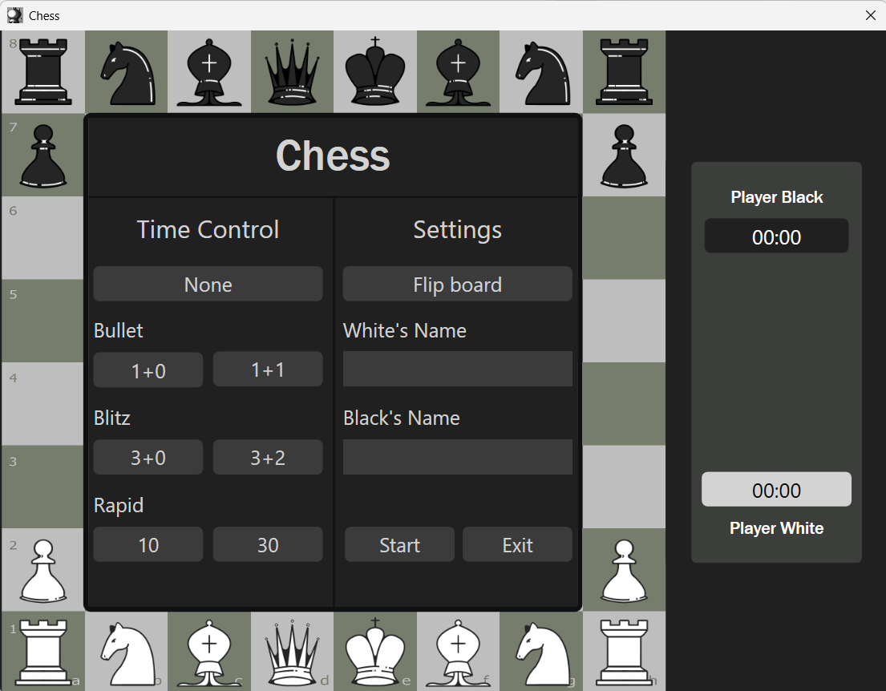
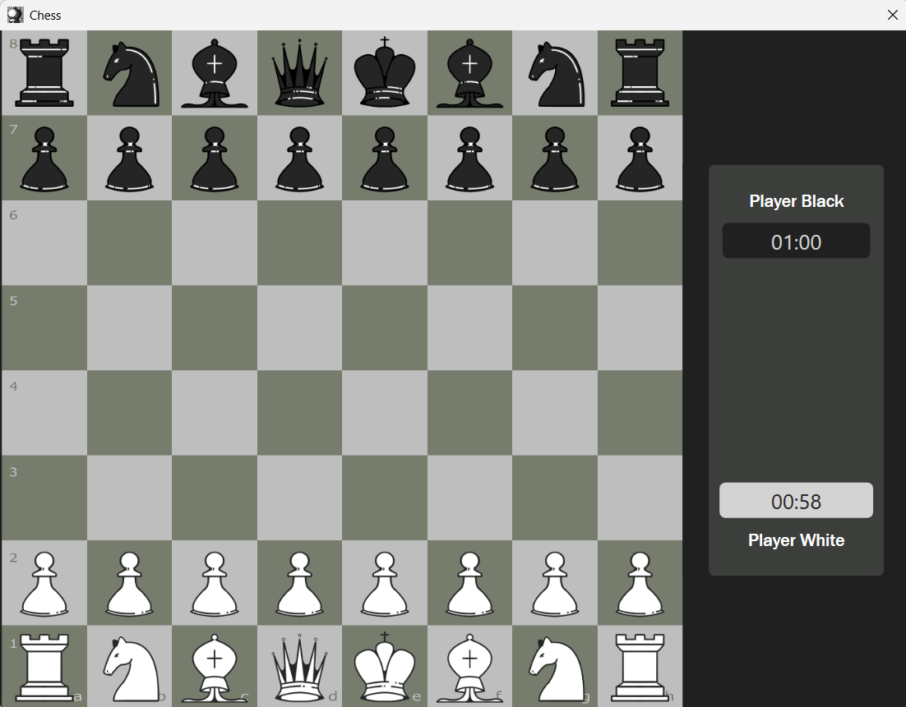

# Chess

A two-player chess game for Windows, built with C# and WPF (.NET 8).
Two players share one computer (local play, no AI opponent).



## Features

- Full chess rules: castling, en passant, pawn promotion, double pawn moves
- Game endings: checkmate, stalemate, time out, fifty-move rule,
  insufficient material, threefold repetition
- Time controls: Bullet (1+0, 1+1), Blitz (3+0, 3+2), Rapid (10, 30), or no clock
- Custom player names, board flip option
- Pause menu, restart, game-over screen

## Download

Get the latest version from the [Releases](../../releases) page.
Unzip and run `Chess_UI.exe`. No installation needed.

> Windows may show a SmartScreen warning because the app isn't signed.
> Click "More info" → "Run anyway".

## Build from source

Requirements: Windows, [.NET 8 SDK](https://dotnet.microsoft.com/download/dotnet/8.0)

```bash
git clone https://github.com/hammerheartt/chess-game.git
cd chess-game
dotnet run --project Chess_UI
```

Or open `Chess.sln` in Visual Studio and press F5.

## Project structure

- `Chess_Logic/`: game rules (board, pieces, moves, game state).
- `Chess_UI/`: WPF interface (windows, menus, piece images).